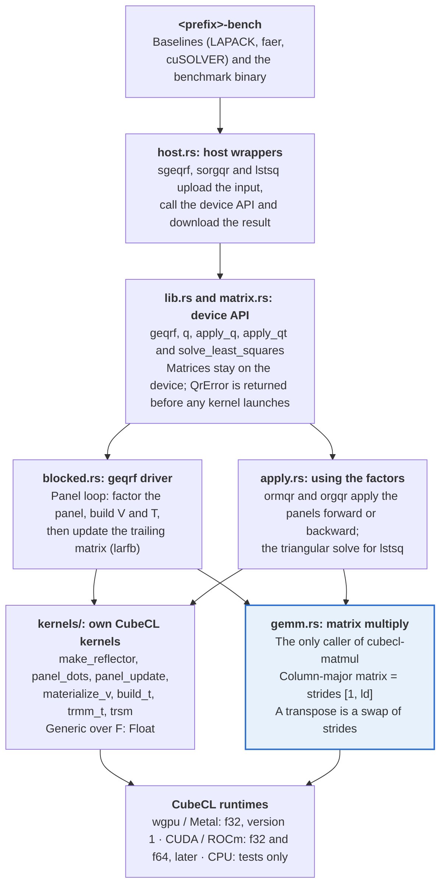

# Design Plan: QR Decomposition on GPUs with Rust and CubeCL

As of 15 November 2026 · George Marklow

Version 1 is a blocked Householder QR factorization of square, column-major f32 matrices (128 to 4096) on wgpu/Metal, written in Rust with CubeCL and benchmarked against LAPACK sgeqrf and the pure-Rust CPU library faer. The design leaves room for explicit Q, least squares, tall-skinny and batched inputs, f64 and other GPU backends.

This plan is the reference for every design-level question. Binding choices are numbered in `docs/decisions.md` (D-001 to D-018), and the work is broken into tasks with gates in `docs/roadmap.md`. The project name and crate prefix are chosen in M0.1; until then this plan writes the library crate as `<prefix>`.

## Scope

Version 1 factors one square matrix at a time and must match LAPACK sgeqrf in accuracy; everything else builds on the same core later.

| Capability | Version 1 | Later |
| --- | --- | --- |
| Square matrices, n = 128 to 4096 | Yes | |
| LAPACK-style compact output (R, Householder vectors, τ) | Yes | |
| Explicit Q (orgqr) | | Yes |
| Apply Q or Qᵀ to a matrix (ormqr) | | Yes |
| Least-squares solve | | Yes |
| Tall-skinny matrices (TSQR) | | Yes |
| Batched small matrices | | Yes |
| wgpu / Metal, f32 | Yes | |
| CUDA / ROCm, f64 | | Yes |
| CubeCL CPU runtime | Tests only | Tests only |
| Column pivoting (QRCP) | No | Separate function, if needed |

The main uses are benchmarking against LAPACK, least-squares solves, building orthonormal bases, and serving as a building block inside eigenvalue and SVD algorithms.

## Design decisions

These choices were made in the design discussion and fix the shape of the library. Each has a decision entry in `docs/decisions.md`.

| Topic | Decision | Reason |
| --- | --- | --- |
| Algorithm | Blocked Householder QR, compact WY form | Keeps Q orthogonal to machine precision; most work becomes matrix multiplies |
| First goal | Square matrices vs LAPACK sgeqrf | Reuses the LU benchmark setup |
| Data location | Device-first API, host-slice wrappers on top | Chained calls avoid host transfers |
| CPU runtime | Correctness tests only | Its 0.7 compiler rejects nested loops and loops inside if blocks |
| Matrix multiply | cubecl-matmul, behind one wrapper module | Tuned kernels; API changes stay in one file |
| Layout | Column-major with a leading dimension | Matches LAPACK; views without copies |
| Precision | Generic over the float type, checked per device | Metal has no f64 |
| Errors | Result with a QrError enum | Callers can recover from bad input |
| Pivoting | Not in version 1 | Hard to block on a GPU; can be added as its own function |
| Correctness | Residual, orthogonality, match with sgeqrf | All three, tested at every size |
| Baselines | LAPACK sgeqrf and faer on the CPU; cuSOLVER geqrf for the later CUDA backend | No Rust library offers GPU QR on Apple Silicon, so the comparison is against the best CPU code in Fortran/C and in Rust |

## Mathematics of QR

Each column is reduced by one Householder reflector, and the library follows LAPACK's slarfg conventions exactly so its output can be compared with sgeqrf value for value.

### The factorization

For A of size m × n with m ≥ n, the QR factorization writes A as an orthogonal matrix Q times an upper triangular matrix R:

```math
A = QR, \qquad Q \in \mathbb{R}^{m \times m},\ Q^{\mathsf{T}} Q = I, \qquad R \in \mathbb{R}^{m \times n} \text{ upper triangular}
```

Q is never stored directly. It is the product of k = min(m, n) Householder reflectors:

```math
Q = H_1 H_2 \cdots H_k, \qquad H_j = I - \tau_j v_j v_j^{\mathsf{T}}
```

Each v_j is zero in its first j − 1 entries and 1 in entry j, so only entries j + 1 to m need storing.

### Building one reflector (slarfg)

Given the column below and including the diagonal, x of length p, split it into its first entry α and the rest x₂, and compute the norm of the rest:

```math
x = \begin{pmatrix} \alpha \\ x_2 \end{pmatrix}, \qquad \sigma = \lVert x_2 \rVert_2
```

If σ = 0 the column is already reduced: τ = 0, H = I and β = α. Otherwise:

```math
\beta = -\operatorname{sign}(\alpha)\,\sqrt{\alpha^2 + \sigma^2}, \qquad \tau = \frac{\beta - \alpha}{\beta}, \qquad v = \begin{pmatrix} 1 \\ \dfrac{x_2}{\alpha - \beta} \end{pmatrix}
```

Then H x = β e₁. The sign choice makes α − β a sum of two numbers with the same sign, so it never cancels, and it keeps τ between 1 and 2. H is orthogonal because τ equals 2 divided by vᵀv.

### Safe norms in f32

A plain sum of squares overflows above about 1.8 × 10¹⁹ and underflows below about 10⁻¹⁹ in f32. The norm kernel scales by the largest entry first, as LAPACK's snrm2 does:

```math
s = \max_i |x_i|, \qquad \lVert x \rVert_2 = s \sqrt{\sum_i \left(\frac{x_i}{s}\right)^{2}}
```

### Unblocked factorization (geqr2)

For each column j from 1 to k:

1. Build H_j from A(j:m, j), giving β_j, τ_j and v_j.
2. Store β_j in A(j, j) and v_j(2:) in A(j+1:m, j).
3. Apply H_j to the columns to the right, A₂ = A(j:m, j+1:n):

```math
w^{\mathsf{T}} = v_j^{\mathsf{T}} A_2, \qquad A_2 \leftarrow A_2 - \tau_j\, v_j\, w^{\mathsf{T}}
```

When the loop ends, R occupies the upper triangle of A, the reflectors sit below the diagonal, and the τ values are returned separately. This is exactly the layout sgeqrf produces.

## Blocked algorithm

The matrix is factored in panels of nb columns (64 to start), and each panel's reflectors are combined into one block reflector so the rest of the matrix is updated with matrix multiplies.

### Compact WY form

The product of the b reflectors in a panel can be written with an upper triangular b × b matrix T:

```math
H_1 H_2 \cdots H_b = I - V T V^{\mathsf{T}}, \qquad V = \begin{pmatrix} v_1 & v_2 & \cdots & v_b \end{pmatrix}
```

V is unit lower trapezoidal: ones on its diagonal and zeros above it.

### Building T (slarft)

T is built one column at a time, starting from T₁ = τ₁:

```math
T_i = \begin{pmatrix} T_{i-1} & -\tau_i\, T_{i-1}\, V_{1:i-1}^{\mathsf{T}} v_i \\ 0 & \tau_i \end{pmatrix}, \qquad i = 2, \dots, b
```

The vector Vᵀv_i is a small matrix-vector product. Building T costs about b² × (m − j) flops per panel, small next to the trailing update.

### Updating the trailing matrix (slarfb)

The factorization applies Qᵀ to the columns right of the panel. With A₂ = A(j:m, j+b:n):

```math
\left(I - V T V^{\mathsf{T}}\right)^{\mathsf{T}} A_2 = A_2 - V\, T^{\mathsf{T}} \left(V^{\mathsf{T}} A_2\right)
```

This runs as three steps, two of them large matrix multiplies through cubecl-matmul:

```math
W = V^{\mathsf{T}} A_2, \qquad W \leftarrow T^{\mathsf{T}} W, \qquad A_2 \leftarrow A_2 - V W
```

W is b × (n − j − b). The middle step is a small triangular multiply done by its own kernel.

### Driver loop (geqrf)

For each panel start j = 0, nb, 2nb, … with width b = min(nb, k − j):

1. Factor the panel A(j:m, j:j+b) with the unblocked algorithm.
2. Copy V out of the panel into a workspace, writing the implicit ones and zeros, so the matrix multiply sees a plain dense matrix.
3. Build T from V and the panel's τ values.
4. If columns remain to the right, update A₂ with the three steps above.

The workspace holds V (m × nb), T (nb × nb) and W (nb × n) and is allocated once per call.

## Applying Q, forming Q and least squares

All three reuse the block update from the factorization, applied panel by panel to a different matrix, so they need no new heavy kernels.

### Applying Qᵀ or Q (ormqr)

With p panels whose block reflectors are I − VᵢTᵢVᵢᵀ, the transpose of Q is applied by walking the panels forward, and Q itself by walking them backward:

```math
Q^{\mathsf{T}} C = \left(I - V_p T_p^{\mathsf{T}} V_p^{\mathsf{T}}\right) \cdots \left(I - V_1 T_1^{\mathsf{T}} V_1^{\mathsf{T}}\right) C
```

```math
Q C = \left(I - V_1 T_1 V_1^{\mathsf{T}}\right) \cdots \left(I - V_p T_p V_p^{\mathsf{T}}\right) C
```

Each factor touches only the rows its panel covers. The T matrices can be kept from the factorization or rebuilt, which trades nb × k floats of memory against recomputation.

### Forming Q explicitly (orgqr)

The thin Q, the first n columns, is Q applied to the first n columns of the identity:

```math
Q_1 = Q \begin{pmatrix} I_n \\ 0 \end{pmatrix} \in \mathbb{R}^{m \times n}
```

It is built by starting from that identity block and applying the panels backward, as for QC. The full m × m Q starts from I_m instead. Forming the thin Q costs about as much again as the factorization.

### Least squares

For full-rank A with m ≥ n, the least-squares problem has a closed solution through R. Split Qᵀb into its first n entries c and the rest d:

```math
\min_x \lVert A x - b \rVert_2, \qquad Q^{\mathsf{T}} b = \begin{pmatrix} c \\ d \end{pmatrix}, \qquad R_1 x = c, \qquad \min_x \lVert A x - b \rVert_2 = \lVert d \rVert_2
```

R₁ is the top n × n block of R. The system R₁x = c is solved by back substitution:

```math
x_i = \frac{1}{r_{ii}} \left( c_i - \sum_{j = i+1}^{n} r_{ij}\, x_j \right), \qquad i = n, n-1, \dots, 1
```

Several right-hand sides B are handled at once, one column per thread group. A zero or tiny rᵢᵢ means A is rank-deficient; version 1 reports that as an error rather than pivoting.

## Public API

The core API works on matrices that stay on the device, and a thin host module wraps it with LAPACK-like signatures for benchmarks and quick use.

```rust
/// Column-major matrix on a device. Element (i, j) is at offset + j * ld + i.
/// `ld` (leading dimension) allows panel and trailing-block views without copying.
pub struct DeviceMatrix<R: Runtime, F: Float> {
    handle: Handle,
    offset: usize,
    rows: usize,
    cols: usize,
    ld: usize,
    _marker: PhantomData<(R, F)>,
}

pub struct QrConfig {
    pub panel_width: u32, // nb, default 64
    pub cube_dim: u32,    // threads per cube, a power of two, default 256
}

/// Compact factorization: R in the upper triangle, reflectors below it, plus tau.
pub struct QrFactors<R: Runtime, F: Float> {
    a: DeviceMatrix<R, F>,
    tau: Handle,
    k: usize,
}

pub fn geqrf<R: Runtime, F: Float>(
    client: &ComputeClient<R::Server, R::Channel>,
    a: DeviceMatrix<R, F>, // consumed: overwritten in place
    config: &QrConfig,
) -> Result<QrFactors<R, F>, QrError>;

impl<R: Runtime, F: Float> QrFactors<R, F> {
    pub fn r(&self) -> Result<DeviceMatrix<R, F>, QrError>;
    pub fn q(&self, thin: bool) -> Result<DeviceMatrix<R, F>, QrError>;
    pub fn apply_qt(&self, c: &mut DeviceMatrix<R, F>) -> Result<(), QrError>;
    pub fn apply_q(&self, c: &mut DeviceMatrix<R, F>) -> Result<(), QrError>;
    pub fn solve_least_squares(&self, b: DeviceMatrix<R, F>)
        -> Result<DeviceMatrix<R, F>, QrError>;
}

pub enum QrError {
    InvalidShape { rows: usize, cols: usize, reason: &'static str },
    UnsupportedPrecision { device: String },
    InvalidConfig(&'static str),
    RankDeficient { column: usize },
}

/// Host wrappers with LAPACK-like signatures.
pub mod host {
    pub fn sgeqrf(a: &mut [f32], m: usize, n: usize) -> Result<Vec<f32>, QrError>;
    pub fn sorgqr(a: &[f32], tau: &[f32], m: usize, n: usize) -> Result<Vec<f32>, QrError>;
    pub fn lstsq(a: &[f32], b: &[f32], m: usize, n: usize, nrhs: usize)
        -> Result<Vec<f32>, QrError>;
}
```

- **Precision:** kernels are generic over F. geqrf checks the device first and returns UnsupportedPrecision for f64 on Metal.
- **Compact factors first:** Q, QᵀC and least squares are methods on QrFactors, mirroring how LAPACK separates geqrf, ormqr and orgqr.
- **Matrix multiply:** one internal module, gemm.rs, is the only caller of cubecl-matmul. It describes a column-major matrix as a strided tensor with shape [rows, cols] and strides [1, ld], so a transpose is a swap of strides.
- **Errors:** QrError covers what can be checked before launching. In CubeCL 0.7 a failed launch panics inside CubeCL and cannot be returned.

## Kernels and launch plan

Version 1 needs six small kernels plus cubecl-matmul, at about 3b + 6 launches per panel of width b.

| Kernel | Computes | Grid | Launches |
| --- | --- | --- | --- |
| make_reflector | Scaled norm of the column, then β, τ and v (slarfg), all in one cube | 1 cube, cube_dim threads | 1 per column |
| panel_dots | wᵀ = vᵀA₂ for the remaining panel columns, one reduction per column | 1 cube per remaining column | 1 per column |
| panel_update | A₂ ← A₂ − τ v wᵀ inside the panel | 2D grid over rows × panel columns | 1 per column |
| materialize_v | Copy V out of the panel, writing the implicit ones and zeros | 2D grid over the panel | 1 per panel |
| build_t | T from S = VᵀV (a gemm) with the slarft recurrence | gemm, then 1 cube of b threads | 2 per panel |
| trmm_t | W ← TᵀW with T upper triangular | 2D grid over W | 1 per panel |
| gemm (cubecl-matmul) | W = VᵀA₂ and A₂ ← A₂ − VW | Chosen by cubecl-matmul | 2 per panel |

make_reflector fuses the norm and the reflector the same way the LU pivot kernel fused the search and the swap: each thread reads α into shared memory before the barrier, so no thread reads a value another thread rewrites.

build_t uses the matrix S = VᵀV, computed once by gemm, in place of a separate product Vᵀvᵢ for each column:

```math
S = V^{\mathsf{T}} V, \qquad T_{1:i-1,\,i} = -\tau_i\, T_{1:i-1,\,1:i-1}\, S_{1:i-1,\,i}
```

The column-by-column panel work dominates the launch count. For n = 4096 and nb = 64 that is 64 panels × 198 launches, about 12,700 launches. A fused panel kernel or a TSQR panel would cut this later.

## Accuracy and testing

Every test checks the residual, the orthogonality of Q and agreement with sgeqrf, using LAPACK's own test ratios and a pass threshold of 30.

### Test ratios

Following LAPACK's QR tests (xQRT01), both errors are scaled by the matrix size and the machine epsilon ε, so one threshold works at every size:

```math
\rho_{\text{res}} = \frac{\lVert A - QR \rVert_1}{m\, \lVert A \rVert_1\, \varepsilon}, \qquad \rho_{\text{orth}} = \frac{\lVert I - Q^{\mathsf{T}} Q \rVert_1}{m\, \varepsilon}, \qquad \varepsilon = 2^{-23} \approx 1.19 \times 10^{-7}
```

A test passes when both ratios are below 30. Householder QR is backward stable, so a correct implementation stays far below that; a bug in an index or a race pushes the ratios to 10⁴ or more.

The ratios are computed on the CPU in f64. Until orgqr exists (M3.2), Q comes from the f64 reference module (M0.3), which multiplies out the Hⱼ from v and τ, so the factorization can be tested from M1 on.

### Matching sgeqrf

Because the reflectors follow slarfg's sign convention, R and τ should match LAPACK entry by entry, up to rounding. The comparison is relative to the size of A:

```math
\delta_R = \frac{\max_{i \le j} \left| r_{ij} - r^{\text{LAPACK}}_{ij} \right|}{\lVert A \rVert_{\max}}, \qquad \delta_\tau = \max_j \left| \tau_j - \tau^{\text{LAPACK}}_j \right|
```

Blocking changes the order of additions, so the bound grows with n. The starting tolerance is 10⁻⁴ for n ≤ 512 and 10⁻³ above, tightened once real numbers are in.

### Test matrices

| Case | Sizes | What it catches |
| --- | --- | --- |
| Random entries in [0, 1), fixed seed | 4, 16, 128, 1024, 4096 | General correctness, same inputs as the LU benchmark |
| Not a multiple of nb | 100, 1000 | Partial last panel |
| A zero column | 64 | The τ = 0 branch of slarfg |
| Identity and diagonal | 64 | Columns already reduced |
| Ill-conditioned, singular values from 1 to 10⁻⁶ | 256 | Loss of orthogonality |
| Huge and tiny entries, near 10³⁰ and 10⁻³⁰ | 64 | Overflow and underflow in the norm |

Tests run on wgpu. The same tests run on the CubeCL CPU runtime where its compiler accepts the kernels, and are marked ignored there otherwise. Comparisons with LAPACK live in `<prefix>-bench`, the only crate with a LAPACK dependency.

## Performance model

QR does twice the arithmetic of LU, almost all of it in the trailing matrix multiplies, so launch overhead decides small sizes and matmul speed decides large ones.

### Flop count

Householder QR of an m × n matrix with m ≥ n costs:

```math
F_{\text{geqrf}}(m, n) = 2mn^2 - \tfrac{2}{3} n^3, \qquad F_{\text{geqrf}}(n, n) = \tfrac{4}{3} n^3
```

The benchmark reports effective throughput from the median time t in seconds, the same way as the LU benchmark but with QR's count:

```math
\text{GFLOP/s} = \frac{\tfrac{4}{3} n^3}{t \times 10^{9}}
```

The panel work, which does not go through matmul, is a small share for large n:

```math
\frac{F_{\text{panel}}}{F_{\text{geqrf}}} \approx \frac{3\, n_b}{4\, n}
```

For n = 4096 and nb = 64 that is about 1.2%.

### Launch overhead

The LU work measured about 15 µs per kernel launch on wgpu/Metal. With 3nb + 6 launches per panel and n / nb panels:

| n | Panels | Launches | Launch time at 15 µs | Flops |
| --- | --- | --- | --- | --- |
| 128 | 2 | 396 | 6 ms | 2.8 × 10⁶ |
| 512 | 8 | 1,584 | 24 ms | 1.8 × 10⁸ |
| 1024 | 16 | 3,168 | 48 ms | 1.4 × 10⁹ |
| 2048 | 32 | 6,336 | 95 ms | 1.1 × 10¹⁰ |
| 4096 | 64 | 12,672 | 190 ms | 9.2 × 10¹⁰ |

Assuming cubecl-matmul reaches 1 TFLOP/s on the Mac's GPU, the arithmetic at n = 4096 takes about 90 ms, less than the 190 ms of launches. So launches are likely to dominate at every size up to 4096, and fusing the per-column panel kernels is the first optimisation after version 1.

Changing nb barely moves the launch count, because the total is 3n + 6n/nb and the three launches per column remain. It instead trades panel work against the size of the matrix multiplies; the benchmark should sweep nb = 32, 64 and 128.

## Workspace layout

The Cargo workspace has two crates and an xtask, so the library itself stays free of C dependencies. All baselines (LAPACK, faer, cuSOLVER) live in the bench crate.

```
Cargo.toml                 workspace, shared dependencies and lints
crates/
  <prefix>/                the library: pure Rust + CubeCL
    src/lib.rs             public API, QrError, QrConfig
    src/matrix.rs          DeviceMatrix: upload, download, views
    src/kernels/
      householder.rs       make_reflector, panel_dots, panel_update
      larft.rs             materialize_v, build_t
      trmm.rs              trmm_t
      trsm.rs              back substitution
    src/gemm.rs            the only caller of cubecl-matmul
    src/blocked.rs         geqr2 and geqrf drivers
    src/apply.rs           larfb, ormqr, orgqr
    src/host.rs            host-slice wrappers
    src/reference.rs       f64 reference QR and test ratios (tests and the "reference" feature)
    tests/                 GPU and CPU-runtime tests
  <prefix>-bench/          baseline comparison tests and the benchmark binary
    src/main.rs            timed runs, CSV output
    src/lapack.rs          safe wrappers for sgeqrf, sorgqr, sgels
    src/faer.rs            faer QR baseline (D-019)
    src/cusolver.rs        cuSOLVER geqrf baseline, `cuda` feature only (D-020)
    tests/                 agreement with LAPACK
scripts/plot_results.py    linear and log-log plots from a results CSV
xtask/                     cargo xtask verify, fmt, bench
```

## Architecture



Each layer calls only the layer below it. Isolating cubecl-matmul in gemm.rs means a CubeCL upgrade that changes its API touches one file.

## Roadmap

The detailed tasks, their completion criteria and the gates are in `docs/roadmap.md`. In summary:

| Milestone | Delivers | Gate |
| --- | --- | --- |
| M0 Foundations | Workspace, DeviceMatrix, QrError, f64 reference QR, test matrices, LAPACK and faer harness | Device round trip; the reference matches sgeqrf |
| M1 Unblocked QR | make_reflector, panel_dots, panel_update, geqr2 driver | geqr2 on wgpu matches sgeqrf at n = 4, 16, 128 |
| M2 Blocked QR (version 1) | gemm wrapper, V and T, trmm_t, blocked geqrf, benchmark | n = 100 to 4096 pass; benchmark CSV and plots against sgeqrf and faer |
| M3 Using the factors | apply_q, apply_qt, explicit Q, back substitution, least squares | Q orthogonal; least squares matches sgels |
| M4 Performance | Launch-cost measurement, fused panel kernel | Faster than M2 at n = 4096 |

TSQR, batched QR, f64 on CUDA or ROCm (with the cuSOLVER baseline) and column pivoting are in the backlog.

## Open questions and risks

- **Project name:** chosen in M0.1 after checking crates.io (D-018).
- **Testing f64:** there is no CUDA or ROCm device on the Mac, so f64 needs other hardware or a CI runner.
- **GPU tests in CI:** GitHub-hosted runners have no GPU; D-016 decides whether lavapipe works or GPU tests run only locally.
- **cubecl-matmul API:** it changes between releases; pinning the CubeCL version (D-012) and keeping all calls in gemm.rs limits the damage. M2.1 confirms how to call it.
- **Launch overhead:** the model above predicts launches dominate up to n = 4096, so version 1 will likely be slower than LAPACK at every size until the panel is fused.
- **CPU runtime:** its 0.7 compiler bugs mean some tests can only run on the GPU.
- **Storing T:** keeping each panel's T after geqrf speeds up apply_q and q but costs nb × k floats; decided in M3.1 (D-015).
